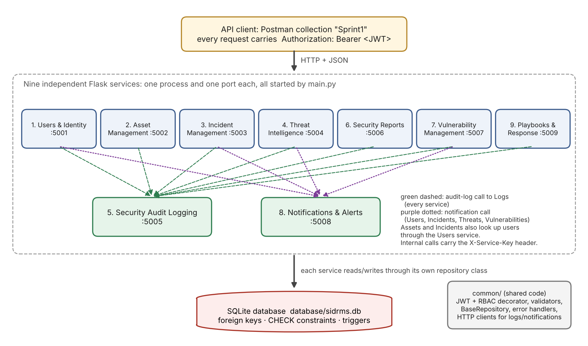
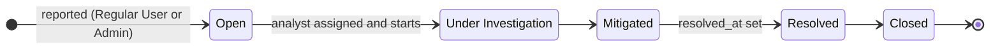
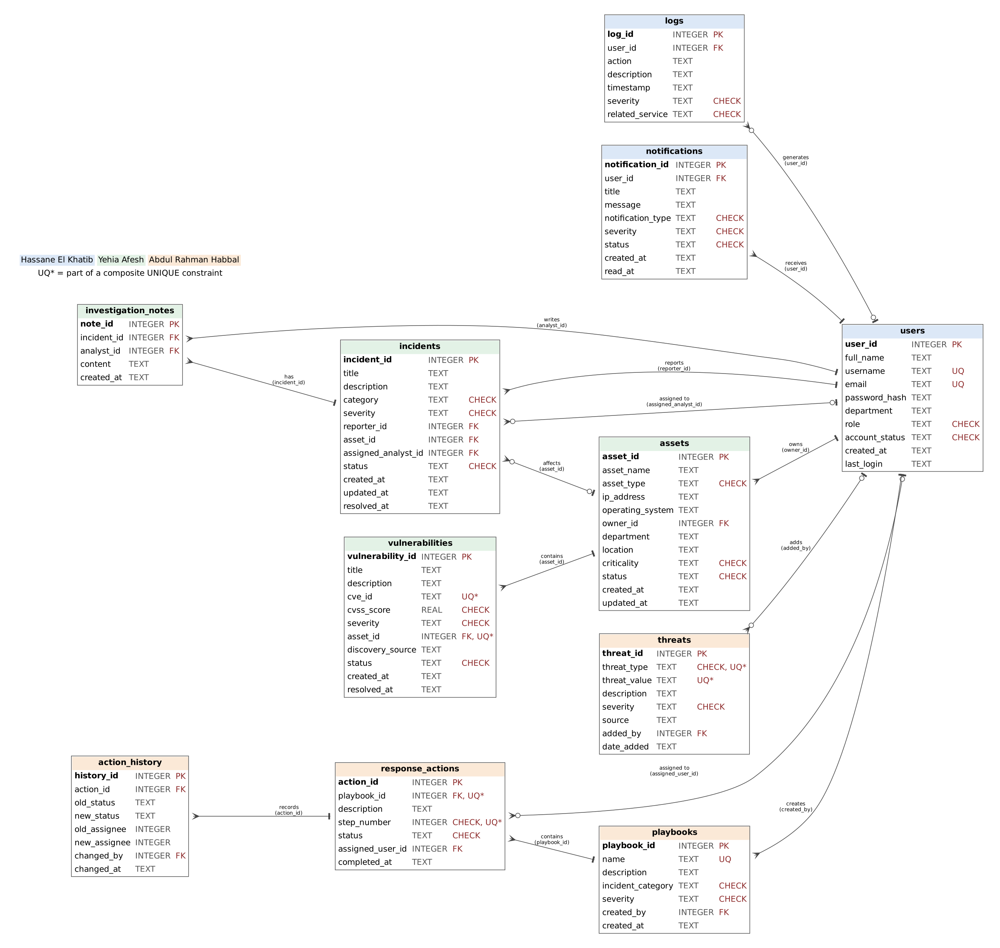

# Security Incident Detection and Response Management System (SIDRMS)

A backend that lets an organisation record and investigate cybersecurity incidents, keep an inventory of its assets, track the vulnerabilities found on them, store threat intelligence, run response playbooks and keep an immutable audit trail of every security action.

It is made of **nine independent Flask REST services**. They share one SQLite database, protect every route with **JWT authentication and role-based access control**, and call each other over HTTP.

> EECE 435L – Software Tools Lab, Final Project, Sprint I
> **Team:** Hassane El Khatib · Yehia Afesh · Abdul Rahman Habbal


---

## Contents

- [Highlights](#highlights)
- [Architecture](#architecture)
- [Services and who built them](#services-and-who-built-them)
- [Quick start](#quick-start)
- [Test accounts](#test-accounts)
- [Examples](#examples)
- [Roles and permissions](#roles-and-permissions)
- [Database](#database)
- [Validation, errors and security](#validation-errors-and-security)
- [Testing with Postman](#testing-with-postman)
- [Project structure](#project-structure)
- [Development conventions](#development-conventions)
- [Team](#team)
- [License](#license)

---

## Highlights

- **54 REST endpoints** across 9 services, each running in its own process on its own port. One command (`python main.py`) starts them all.
- **JWT login with bcrypt-hashed passwords.** Every service checks the token on its own, and access is controlled by four roles: Security Administrator, Security Analyst, Regular User and Auditor.
- **Ownership rules on top of roles.** Analysts only touch the incidents assigned to them, and employees only see the incidents they reported.
- **Real workflows, not just CRUD:**
  - Incident lifecycle: Open → Under Investigation → Mitigated → Resolved → Closed.
  - Vulnerability lifecycle with CVSS/severity consistency checks.
  - Ordered playbook steps that cannot start before the earlier ones are done.
- **Immutable audit log.** Every create, update, delete, login and refused request is logged, and database triggers block any edit of a log record.
- **Automatic notifications:**
  - an analyst is told when an incident is assigned to them;
  - administrators are alerted when a Critical incident or vulnerability is recorded;
  - reporters are told when the status of their incident changes.
- **Six live security reports** computed from the shared database with read-only aggregate queries.
- **Defensive by default:**
  - parameterised SQL everywhere;
  - whitelisted columns;
  - strict input validation;
  - one JSON error format across all services.
- **Object-oriented design.** Entity models, a shared `BaseRepository` that every repository inherits from, and a `common/` package reused by all services.
- **A Postman collection of 194 requests**, each with a description and a status-code test. All of them pass on a fresh database.

---

## Architecture



- **Client → services.** A client logs in through the Users service and receives a JWT valid for 60 minutes. It sends that token as `Authorization: Bearer <token>` to any service. All services share the signing secret, so each one verifies tokens on its own.
- **Service → service.** Services call each other through small HTTP clients in `common/clients.py`, using an internal `X-Service-Key` header:
  - every service writes audit records to the Logs service;
  - Users, Incidents, Vulnerabilities, Threats and Playbooks send notifications;
  - Assets, Incidents and Playbooks look up users to check that an owner, analyst or assignee exists.
- **Service → database.** Each service reads and writes its own tables through its own repository class. The Reports service only reads, with `COUNT`/`GROUP BY` queries over everyone's tables.
- **Resilience.** A failed internal call (for example Logs being down) never breaks the user's request. The main operation is already saved, and the problem is printed on the console.

---

## Services and who built them

| # | Service | Port | Main endpoints | Developed by |
|---|---|---|---|---|
| 1 | Users & Identity | 5001 | `POST /users/register`, `POST /users/login`, `PUT/DELETE /users/{id}`, `GET /users`, `GET /users/{username}` | Hassane El Khatib |
| 2 | Asset Management | 5002 | `POST/GET /assets`, `PUT/DELETE/GET /assets/{id}`, `GET /assets/search` | Yehia Afesh |
| 3 | Incident Management | 5003 | `POST/GET /incidents`, `GET /incidents/{id}`, `PUT /incidents/{id}/assign`, `PUT /incidents/{id}/status`, `POST /incidents/{id}/notes` | Yehia Afesh |
| 4 | Threat Intelligence | 5004 | `POST/GET /threats`, `GET/PUT/DELETE /threats/{id}`, `GET /threats/search` | Abdul Rahman Habbal |
| 5 | Security Audit Logging | 5005 | `POST/GET /logs`, `GET/DELETE /logs/{id}`, `GET /logs/search`, `GET /logs/user/{user_id}` | Hassane El Khatib |
| 6 | Security Reports | 5006 | `GET /reports/summary`, `/incidents`, `/assets`, `/threats`, `/vulnerabilities`, `/activity` | Abdul Rahman Habbal |
| 7 | Vulnerability Management | 5007 | `POST/GET /vulnerabilities`, `GET/PUT/DELETE /vulnerabilities/{id}`, `GET /vulnerabilities/search` | Yehia Afesh |
| 8 | Notifications & Alerts | 5008 | `POST /notifications`, `GET /notifications/user/{id}`, `GET/DELETE /notifications/{id}`, `PUT /notifications/{id}/read`, `GET /notifications/search` | Hassane El Khatib |
| 9 | Playbooks & Response | 5009 | `POST/GET /playbooks`, `GET/DELETE /playbooks/{id}`, `POST /playbooks/{id}/actions`, `PUT /actions/{id}/status` | Abdul Rahman Habbal |

Shared work:

- **Hassane El Khatib:** the `common/` package (auth, RBAC, validation, errors, repositories, service clients), database setup and `main.py`.
- **Yehia Afesh:** database design and ERD.
- **Abdul Rahman Habbal:** final Postman collection and report assembly.

Every route's docstring ends with `Developed by: <Full Name>`, and every Postman request name starts with the developer's full name.

---

## Quick start

Requires **Python 3.10+** and Git.

### Linux / macOS

```bash
git clone https://github.com/Hassane-El-Khatib/Final_Project_435L_Sprint1.git
cd Final_Project_435L_Sprint1
python3 -m venv venv
source venv/bin/activate
pip install -r requirements.txt
cp .env.example .env
python -m database.init_db --reset
python main.py
```

### Windows (PowerShell)

```powershell
git clone https://github.com/Hassane-El-Khatib/Final_Project_435L_Sprint1.git
cd Final_Project_435L_Sprint1
python -m venv venv
venv\Scripts\activate
pip install -r requirements.txt
copy .env.example .env
python -m database.init_db --reset
python main.py
```

If PowerShell refuses to run the activate script, run `Set-ExecutionPolicy -Scope CurrentUser RemoteSigned` once.

### Expected output

```text
Database ready: .../database/sidrms.db
  action_history            5 rows
  assets                    8 rows
  incidents                 4 rows
  investigation_notes       1 rows
  logs                      0 rows
  notifications             3 rows
  playbooks                 2 rows
  response_actions          9 rows
  threats                   8 rows
  users                     8 rows
  vulnerabilities           5 rows

  users            running on http://127.0.0.1:5001
  assets           running on http://127.0.0.1:5002
  incidents        running on http://127.0.0.1:5003
  threats          running on http://127.0.0.1:5004
  logs             running on http://127.0.0.1:5005
  reports          running on http://127.0.0.1:5006
  vulnerabilities  running on http://127.0.0.1:5007
  notifications    running on http://127.0.0.1:5008
  playbooks        running on http://127.0.0.1:5009
All available services started. Press Ctrl+C to stop.
```

Press **Ctrl+C** to stop every service. Run `python -m database.init_db --reset` at any time to go back to the clean sample data.

> Opening `http://127.0.0.1:5001/` in a browser returns `404 Route not found`. That is expected: there is no home page, only the API routes listed above.

### Configuration (`.env`)

| Variable | Default | Purpose |
|---|---|---|
| `JWT_SECRET` | example value | Secret used to sign and verify tokens (change it outside the lab) |
| `SERVICE_KEY` | example value | Shared key for internal service-to-service calls |
| `DB_PATH` | `database/sidrms.db` | SQLite file shared by all services |
| `JWT_EXPIRY_MINUTES` | `60` | Token lifetime |

`.env`, the database file and `venv/` are git-ignored and must never be committed.

---

## Test accounts

Created by `python -m database.init_db --reset`:

| id | username | password | role | status |
|---|---|---|---|---|
| 1 | `admin` | `Admin@1234` | Security Administrator | Active |
| 2 | `analyst1` | `Analyst@1234` | Security Analyst | Active |
| 3 | `analyst2` | `Analyst@1234` | Security Analyst | Active |
| 4 | `employee1` | `Employee@1234` | Regular User | Active |
| 5 | `employee2` | `Employee@1234` | Regular User | Active |
| 6 | `auditor1` | `Auditor@1234` | Auditor | Active |
| 7 | `suspended1` | `Employee@1234` | Regular User | Suspended (login refused) |
| 8 | `inactive1` | `Employee@1234` | Regular User | Inactive (login refused) |

The seed data also contains 8 assets, 4 incidents, 5 vulnerabilities (real CVEs such as Log4Shell and Zerologon), 8 threat indicators and 2 playbooks with 9 response actions. Threat indicators use documentation-only IP ranges, invented domains and the harmless EICAR test hashes.

---

## Examples

All responses below were captured from the running system on a fresh database.

### 1. Log in and get a token

```bash
curl -X POST http://127.0.0.1:5001/users/login \
  -H "Content-Type: application/json" \
  -d '{"username": "admin", "password": "Admin@1234"}'
```

```json
{
  "status": "success",
  "message": "Login successful",
  "token": "eyJhbGciOiJIUzI1NiIs...",
  "data": {
    "user_id": 1,
    "username": "admin",
    "role": "Security Administrator",
    "expires_in_minutes": 60
  }
}
```

Save the token for the next calls (`TOKEN=...` on Linux/macOS, `$TOKEN="..."` in PowerShell).

### 2. Register an asset

```bash
curl -X POST http://127.0.0.1:5002/assets \
  -H "Authorization: Bearer $TOKEN" -H "Content-Type: application/json" \
  -d '{"asset_name": "VPN-GW-01", "asset_type": "Network Device", "ip_address": "10.0.0.5",
       "owner_id": 1, "department": "IT", "criticality": "Critical"}'
```

```json
{
  "status": "success",
  "message": "Asset created successfully",
  "data": {
    "asset_id": 9,
    "asset_name": "VPN-GW-01",
    "asset_type": "Network Device",
    "ip_address": "10.0.0.5",
    "owner_id": 1,
    "owner_name": "Rana Khoury",
    "department": "IT",
    "criticality": "Critical",
    "status": "Active",
    "created_at": "2026-10-20 18:57:56",
    "updated_at": "2026-10-20 18:57:56"
  }
}
```

### 3. Role-based access control in action

The same `GET /users` request, sent with a Security Analyst's token, then with no token:

```json
{"status": "error", "message": "User does not have permission to perform this operation"}
```

```json
{"status": "error", "message": "Authentication required"}
```

Both refusals are written to the audit log automatically:

```json
{
  "log_id": 7,
  "action": "UNAUTHORIZED_ACCESS",
  "description": "Request without authentication token to GET /assets",
  "severity": "Warning",
  "related_service": "assets",
  "timestamp": "2026-10-20 18:57:56"
}
```

### 4. Business rules the services enforce

| Request | Response |
|---|---|
| Move incident 1 from **Open** straight to **Closed** | `400` Invalid status transition from Open to Closed. Next allowed status: Under Investigation |
| Record a vulnerability with **CVSS 9.8** but severity **Low** | `400` Severity Low does not match CVSS score 9.8 (expected Critical) |
| Add an asset with IP `10.0.0.300` | `400` Invalid IP address format for ip_address |
| Add a threat of type File Hash with value `xyz123` | `400` threat_value is not a valid File Hash (expected 32, 40 or 64 hexadecimal characters) |
| Start step 3 of a playbook while step 2 is still in progress | `400` Step 2 must be completed before starting step 3 |
| Delete an asset that still has vulnerabilities | `409` Asset 1 has 2 vulnerabilities; delete or resolve them first |
| Log in with `admin' OR '1'='1` as the username | `401` Invalid username or password (SQL injection has no effect) |

### 5. Incident lifecycle



Each step is one `PUT /incidents/{id}/status`. Skipping a step is refused, the assigned analyst can add investigation notes until the incident is Closed, and the reporter is notified at every change.

### 6. Security summary report (Auditor)

```bash
curl http://127.0.0.1:5006/reports/summary -H "Authorization: Bearer $AUDITOR_TOKEN"
```

```json
{
  "status": "success",
  "message": "Security summary report generated successfully",
  "generated_by": "auditor1",
  "data": {
    "users": 8,
    "assets": 9,
    "open_incidents": 3,
    "critical_threats": 1,
    "total_incidents": 5,
    "incidents_by_severity": {"Low": 2, "Medium": 1, "High": 1, "Critical": 1},
    "threats": 8,
    "open_vulnerabilities": 3,
    "critical_vulnerabilities": 2,
    "users_by_role": {"Security Administrator": 1, "Security Analyst": 2, "Regular User": 4, "Auditor": 1}
  }
}
```

---

## Roles and permissions

| Capability | Admin | Analyst | Regular User | Auditor |
|---|:---:|:---:|:---:|:---:|
| Manage users and roles | ✅ | – | own profile | view |
| Manage assets | ✅ | view / search | – | view / search |
| Report incidents | ✅ | – | ✅ | – |
| View incidents | all | assigned | own | all |
| Assign incidents | ✅ | – | – | – |
| Update incident status, add notes | ✅ | assigned | – | – |
| Add / delete vulnerabilities | ✅ | – | – | – |
| Update vulnerabilities | ✅ | ✅ | – | – |
| Manage threat indicators | ✅ | view / search | – | view |
| Generate reports | ✅ | – | – | ✅ |
| Create / delete playbooks | ✅ | – | – | – |
| Add actions, update action status | ✅ | ✅ | – | – |
| View audit logs | ✅ | view / search | – | ✅ |
| Notifications | all | own | own | view |

Roles are declared on each route with `@require_roles(...)`. Ownership rules are checked inside the route with `deny(...)`. Both return `403` and record an `UNAUTHORIZED_ACCESS` log.

---

## Database



There are 11 tables in `database/schema.sql`, with sample data in `database/seed.sql`. Design choices:

- **Foreign keys are enforced** on every connection (`PRAGMA foreign_keys = ON`). The `ON DELETE` rule of each key follows the meaning of the data:
  - `RESTRICT` protects owners and reporters;
  - `SET NULL` keeps history when something is deleted;
  - `CASCADE` removes notes, notifications and playbook actions together with their parent.
- **Allowed values are enforced twice:** once by the API, with a clear message, and once by `CHECK` constraints in the schema.
- **Uniqueness where duplicates would be wrong:**
  - usernames and emails;
  - a CVE on the same asset;
  - a threat's type and value together;
  - playbook names;
  - step numbers within a playbook.
- **Audit logs cannot be modified:** two triggers abort any `UPDATE` of a log record.

---

## Validation, errors and security

Every error uses the same format and status code mapping:

```json
{"status": "error", "message": "severity must be one of: Low, Medium, High, Critical"}
```

| Code | Meaning | Example |
|---|---|---|
| 400 | Validation failed | missing fields, wrong format, invalid value or transition |
| 401 | Not authenticated | missing, invalid or expired token; wrong password |
| 403 | Not allowed | role not permitted, or not the owner / not assigned |
| 404 | Not found | unknown id, username or route |
| 409 | Conflict | duplicate value, or record still in use |
| 500 | Unexpected error | generic message only; no internal details leak |

Security measures:

- **SQL injection.** All SQL uses `?` parameters, and column names come from fixed whitelists in each repository.
- **Input checks:**
  - unknown body fields and query parameters are refused;
  - empty or non-JSON bodies are refused;
  - every enum value is checked.
- **Passwords.** Passwords are hashed with bcrypt, never returned, and must be at least 8 characters with an uppercase letter, a lowercase letter, a digit and a special character. Login errors do not reveal whether a username exists.
- **Internal endpoints** require the `X-Service-Key` shared by the services.

---

## Testing with Postman

1. Import `postman/Sprint1.postman_collection.json` and `postman/Sprint1_Local.postman_environment.json`.
2. Select the **Sprint1_Local** environment (top right).
3. Run the folder **00 Auth helpers**. It logs in the six test accounts and stores their tokens.
4. Run any service folder, or the whole collection with the Collection Runner.

The collection has **194 requests in 10 folders**. Each request has:

- a name such as `Yehia Afesh - Update Incident Status - Open to Closed rejected [B-43]`;
- a description of the API;
- a test on the expected status code.

On a freshly reset database every test passes. To run the collection again, reset the database first, because the requests create and delete records:

```bash
python -m database.init_db --reset
```

Command-line alternative with [Newman](https://www.npmjs.com/package/newman):

```bash
npx newman run postman/Sprint1.postman_collection.json -e postman/Sprint1_Local.postman_environment.json
```

---

## Project structure

```text
Final_Project_435L_Sprint1/
├── main.py                     # starts all nine services, Ctrl+C stops them
├── requirements.txt
├── .env.example                # copy to .env
├── c_db.py                     # helper that prints tables and report checks
├── common/                     # shared by every service
│   ├── config.py               # ports, URLs, secrets from .env
│   ├── constants.py            # roles, allowed values, status workflows
│   ├── db.py                   # SQLite connection (foreign keys, WAL)
│   ├── base_repository.py      # parameterised CRUD and search, inherited by all repositories
│   ├── auth.py                 # bcrypt, JWT, @require_roles, deny()
│   ├── validators.py           # Validator: body, required fields, email, IP, enums, transitions...
│   ├── errors.py               # typed exceptions + JSON error handlers
│   ├── responses.py            # standard success response
│   ├── clients.py              # log_event, notify, notify_role, get_user
│   ├── app_factory.py          # create_app / run_service
│   └── dev_token.py            # make a test token without logging in
├── database/
│   ├── schema.sql              # 11 tables, keys, constraints, triggers
│   ├── seed.sql                # sample data with fixed ids
│   └── init_db.py              # python -m database.init_db --reset
├── services/
│   └── <service>/              # users, assets, incidents, threats, logs,
│       ├── models.py           # reports, vulnerabilities, notifications, playbooks
│       ├── repository.py
│       └── app.py
├── postman/
│   ├── Sprint1.postman_collection.json
│   └── Sprint1_Local.postman_environment.json
└── docs/
    ├── architecture.png
    └── erd.png
```

---

## Development conventions

- **Responses:** success is `{"status": "success", "message", "count"?, "data"}` and errors are `{"status": "error", "message"}`.
- **Every service has the same layout:**
  - `models.py` holds the entity classes, with `from_row` and `to_dict`;
  - `repository.py` holds a subclass of `BaseRepository`;
  - `app.py` holds the routes.
- **Every route:**
  - is protected with `@require_roles(...)`;
  - validates its input with `Validator` before touching the database;
  - logs every change with `log_event(...)`;
  - ends its docstring with `Developed by: <Full Name>`.
- **Database changes:** new tables go in `database/schema.sql` and their sample rows in `database/seed.sql` (with explicit ids). Then run `python -m database.init_db --reset`.
- **Git workflow:** work on a feature branch, make small meaningful commits, open a pull request, and merge only after another member approves it.

### Adding a route (template)

```python
@app.route("/assets", methods=["POST"])
@require_roles(ADMIN)
def add_asset():
    """Add New Asset.

    Developed by: <Full Name>
    """
    data = Validator.body()
    Validator.require(data, ["asset_name", "asset_type", "ip_address"])
    asset_id = assets.insert({...})
    log_event(g.user["user_id"], "ASSET_CREATED", f"Asset {asset_id} created", "Information", "assets")
    return success(assets.get_with_owner(asset_id).to_dict(), "Asset created successfully", 201)
```

To get a token for quick tests without logging in:

```bash
python -m common.dev_token "Security Analyst" 2 analyst1
```

---

## Team

| Member | Built |
|---|---|
| **Hassane El Khatib** | Users & Identity, Security Audit Logging, Notifications & Alerts, the shared `common/` package, database setup, `main.py` |
| **Yehia Afesh** | Asset Management, Incident Management, Vulnerability Management, database design and ERD |
| **Abdul Rahman Habbal** | Threat Intelligence, Security Reports, Playbooks & Response, Postman collection merge, report assembly |

---

## License

Released under the [MIT License](LICENSE) © 2026 Hassane El Khatib, Yehia Afesh and Abdul Rahman Habbal.

This project was written as coursework for EECE 435L. If you are taking the course, do not submit this code as your own work.

Third-party libraries keep their own licenses:

| Library | License |
|---|---|
| Flask | BSD-3-Clause |
| PyJWT | MIT |
| bcrypt | Apache-2.0 |
| requests | Apache-2.0 |
| python-dotenv | BSD-3-Clause |
